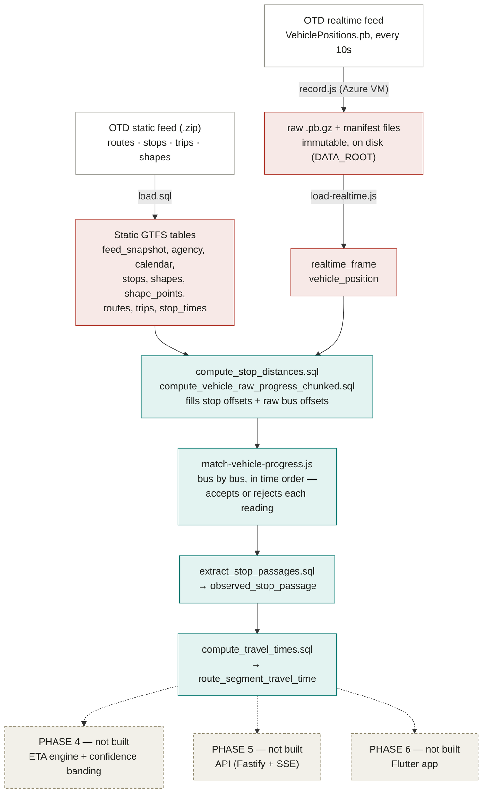
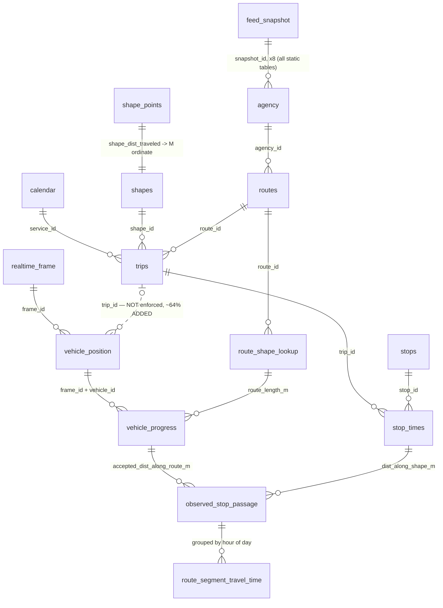

# Low-level design — tables and how they connect

Every table that exists today (Phases 0–3), and how data actually moves
through the five scripts that turn a raw bus position into a trustworthy
answer. Nothing here is new design — it is a map of what's already built in
`db/schema.sql`, `schema_realtime.sql`, `schema_matching.sql`,
`schema_stop_passages.sql` and `schema_travel_times.sql`, plus a marked-off
gap for what isn't built yet. Row counts are as measured in
[static-feed-profile.md](static-feed-profile.md) and
[realtime-feed-profile.md](realtime-feed-profile.md).

Phase 4 has started — see [§ Phase 4, so far](#phase-4-so-far) below for the
one piece that exists (the evaluation harness) and what's still open.

Three colours recur below, and they mean something specific, not just
decoration:

- **Raw** — loaded exactly as the feed sent it, never modified.
- **Derived** — worked out by our own code, and fully rebuildable from raw data.
- **Not built** — designed on paper only (Phase 4 onward).

---

## 1. How data moves

Two feeds come in on separate lanes — a static timetable that barely
changes, and a live position feed that refreshes every ten seconds. They
meet at Phase 2, where a raw GPS point first becomes "this many metres
along the route." Everything past `route_segment_travel_time` is not built.

Five scripts, run in this order, turn a raw GPS point into a travel-time
statistic. The static and realtime feeds are unrelated data until Phase 2 —
that is the first point where a bus's live position is placed against its
printed route.

---

## 2. How the tables connect

Same 13 tables, drawn as a structure instead of a process. The one
relationship worth stopping on: `vehicle_position.trip_id` has **no
foreign key to `trips`** — drawn below as a dashed (non-identifying) link,
not a missing feature. About 64% of live vehicles run a trip the printed
timetable does not know about (`schedule_relationship = ADDED`), so
enforcing that link would silently drop most real buses.

Every static table also carries a foreign key back to `feed_snapshot` —
drawn once above (`feed_snapshot ||--o{ agency`), not repeated eight times.
Full field list for every table is below.

---

## 3. Field-level reference

### Static GTFS — loaded once per snapshot, unmodified

Every row is scoped to a `snapshot_id`, because feeds are kept side by side
rather than overwritten — measuring how stale Delhi's static data goes is a
project goal.

**`feed_snapshot`** — 1 row per downloaded zip, everything else is scoped to this

| field | type | note |
|---|---|---|
| **PK** snapshot_id | serial | auto-numbered |
| label | text, unique | e.g. `delhi_buses_static_gtfs_v1` |
| feed_version | text | `v28` in the current snapshot |
| feed_start / feed_end | date | 2025-01-01 → 2040-01-01, as declared |
| source_dir | text | where it was loaded from |
| imported_at | timestamptz | default now() |
| note | text | free text |

**`agency`** — 2 rows (DTC, DIMTS)

| field | type | note |
|---|---|---|
| **PK/FK** snapshot_id | int | → feed_snapshot |
| **PK** agency_id | text | |
| agency_name | text | not null |
| agency_url, agency_timezone, agency_lang | text | |

**`calendar`** — 1 row: one service, all 7 days, to 2040 — no real calendar

| field | type | note |
|---|---|---|
| **PK/FK** snapshot_id | int | → feed_snapshot |
| **PK** service_id | text | |
| monday … sunday | boolean × 7 | all true, on the one row that exists |
| start_date / end_date | date | |

**`stops`** — 6,872 rows. `stop_name` is not unique — disambiguate by location

| field | type | note |
|---|---|---|
| **PK/FK** snapshot_id | int | → feed_snapshot |
| **PK** stop_id | text | |
| stop_code | text | nullable |
| stop_name | text | not null, not unique — 2,002 names shared |
| stop_lat, stop_lon | double | |
| geom | geometry(Point, 4326) | GiST-indexed on the geography cast |

**`shape_points`** — 770,824 rows, raw and immutable — the only linear reference the feed gives

| field | type | note |
|---|---|---|
| **PK/FK** snapshot_id | int | → feed_snapshot |
| **PK** shape_id | text | |
| **PK** shape_pt_sequence | int | |
| shape_pt_lat, shape_pt_lon | double | |
| shape_dist_traveled | double | 0 blanks — genuinely metres, verified against PostGIS |

**`shapes`** — 2,648 rows, derived `LineStringM` — the M ordinate is the ruler everything else uses

| field | type | note |
|---|---|---|
| **PK/FK** snapshot_id | int | → feed_snapshot |
| **PK** shape_id | text | |
| n_points | int | |
| declared_m | double | length the feed claims |
| geodesic_m | double | length PostGIS actually measures — the two agree to within 0.4% |
| geom | geometry(LineStringM, 4326) | M = shape_dist_traveled; GiST-indexed |

**`routes`** — 2,648 rows. Route↔shape is strictly 1:1, so a "route" here is already one direction

| field | type | note |
|---|---|---|
| **PK/FK** snapshot_id | int | → feed_snapshot |
| **PK** route_id | text | |
| **FK** agency_id | text | → agency |
| route_short_name, route_long_name | text | always identical — real name is in route_desc |
| route_desc | text | the readable "A to B" text |
| route_type | int | |
| direction_tag | text, check UP/DOWN | derived from the name suffix at load time |

**`trips`** — 121,844 rows. Pure timetable expansions — no `block_id`, so a vehicle's next trip is unknowable from static data alone

| field | type | note |
|---|---|---|
| **PK/FK** snapshot_id | int | → feed_snapshot |
| **PK** trip_id | text | = route_id + "_HH_MM" |
| **FK** route_id | text | → routes |
| **FK** service_id | text | → calendar |
| **FK** shape_id | text | → shapes |
| start_s, end_s, n_stops | int | denormalised from stop_times |

**`stop_times`** — 3,855,149 rows, the big one. `arrival_s` always equals `departure_s` — no dwell time modelled

| field | type | note |
|---|---|---|
| **PK/FK** snapshot_id | int | → feed_snapshot |
| **PK/FK** trip_id | text | → trips |
| **PK** stop_sequence | int | starts at 0, not 1 |
| **FK** stop_id | text | → stops |
| arrival_s, departure_s | int (seconds) | not a `TIME` column — 10,497 rows pass 24:00:00 |
| fare_stage | smallint | non-standard GTFS column, kept as-is |
| dist_along_shape_m | double | **NULL** on every row until Phase 2 fills it |

### Realtime — loaded from recorded frames, unmodified

Includes empty frames on purpose — the emptiness itself is a signal about
feed reliability, not something to filter out at load time.

**`realtime_frame`** — 1 row per recorded file. Includes ~44% genuinely empty frames — that's feed behaviour, not a bug

| field | type | note |
|---|---|---|
| **PK** frame_id | serial | |
| source_file | text, unique | makes the loader idempotent |
| day | date | |
| feed_timestamp | timestamptz | `FeedMessage.header.timestamp` |
| vehicle_count | int | 0 means "feed said nothing," never "zero buses running" |
| loaded_at | timestamptz | default now() |

**`vehicle_position`** — 17.4M+ rows so far. No speed/bearing columns — both are unusable in this feed

| field | type | note |
|---|---|---|
| **PK/FK** frame_id | int | → realtime_frame, cascades on delete |
| **PK** vehicle_id | text | |
| route_id, trip_id | text | **no FK** — trip_id often isn't in trips |
| start_time | text | as sent, not cross-checked |
| schedule_relationship | text | SCHEDULED / ADDED / other |
| lat, lon | double | |
| geom | geometry(Point, 4326) | GiST-indexed |
| position_timestamp | timestamptz | can lag the frame's own timestamp by minutes |

### Derived — worked out by our own code, all rebuildable

Nothing here is a source of truth. Every value can be recomputed from the
raw tables above — which is why the working copy gets cleared day by day,
and only the small end results (the last two tables) are kept long-term.

**`route_shape_lookup`** — 1 row per route. Rebuilt fresh every pipeline run, not a permanent table

| field | type | note |
|---|---|---|
| **PK** route_id | text | unique index |
| shape_id, snapshot_id | text / int | |
| route_length_m | double | read from the shape's own end M-value, not a fresh ST_Length — same ruler as bus positions, on purpose |

**`vehicle_progress`** — 1 row per bus sighting. Raw answer vs. the one we actually trust

| field | type | note |
|---|---|---|
| **PK/FK** frame_id, vehicle_id | int, text | → vehicle_position, cascades on delete |
| raw_dist_along_route_m | double | closest-point answer, no memory of earlier readings |
| accepted_dist_along_route_m | double | the trusted value — carries forward when a reading is rejected |
| accepted | boolean | |
| reject_reason | text | NULL, "too fast", or "jumped backward" |

**`observed_stop_passage`** — ~1.25M rows per day. Accumulates across days — survives the daily clear-down

| field | type | note |
|---|---|---|
| **PK** id | serial | |
| day | date | |
| route_id, vehicle_id, trip_id | text | no FK — same reasoning as vehicle_position |
| stop_id, stop_sequence | text, int | |
| dist_along_route_m | double | the stop's own position, not the bus's |
| passage_time | timestamptz | interpolated between two bracketing GPS readings |

**`route_segment_travel_time`** — 68,758 segments. Phase 3's actual deliverable — the raw material for a confidence-banded ETA

| field | type | note |
|---|---|---|
| **PK** route_id | text | |
| **PK** to_stop_sequence | int | travel time into this stop, from the one before |
| **PK** hour_of_day | int | -1 = pooled sentinel (not NULL — can't sit in a primary key), else 0–23 |
| from_stop_id, to_stop_id | text | |
| sample_count | int | low count → treat the statistic as less trustworthy |
| median, p25, p75, mean, stddev_seconds | double | stddev is nullable, the rest are not |

---

## Phase 4, so far

One piece of Phase 4 is done: [`db/evaluate_travel_time_predictions.sql`](../db/evaluate_travel_time_predictions.sql)
checks whether `route_segment_travel_time` is actually any good at
predicting real travel times, before any ETA-serving code gets built on
top of it. Method: hold out one full day (Thu 2026-08-13), train stats on
the other six, then compare predictions against 1.26M real hops the model
never saw.

| | |
|---|---|
| median absolute error | 16.5s |
| within 30s | 67% |
| route-segment coverage | 99.99% |
| hour-of-day-aware MAE vs. flat pooled-only MAE | 43.8s vs. 47.3s — hourly measurably wins, not assumed |

That script is intentionally separate from the real pipeline — it builds
its own training/test split in temp tables and never touches the
production `route_segment_travel_time`, so this result doesn't depend on
that table having been built with all 7 days.

It answers "is the underlying number trustworthy," not "how do we serve
it." **ETA-serving logic (a bus's live position → an arrival time at a
specific stop) is not built.** There is no ETA table yet. Three open
questions worth settling before writing that schema:

- Does a live ETA read `vehicle_progress` directly, or does Phase 4 need
  its own "current position" table that only holds the latest accepted
  reading per bus?
- The eval harness above uses a flat `sample_count >= 3` cutoff to prefer
  the hourly figure over the pooled one. Is that cutoff (and the resulting
  16.5s/67% numbers) good enough to build the rider-facing confidence band
  directly on, or does the band need its own, more graded logic?
- Where does "no live bus, falling back to timetable" get decided — in the
  database, or in the API layer that doesn't exist yet?
